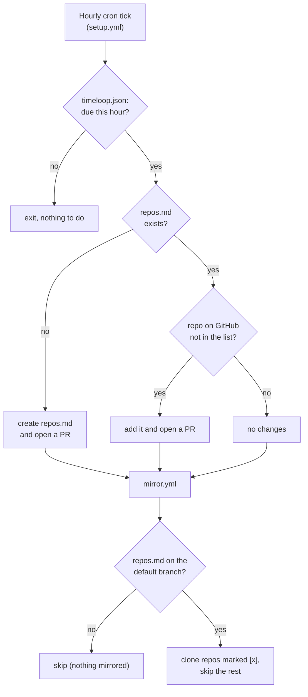

<div align="center">



<br>

[](LICENSE)
[-3776AB?logo=python&logoColor=white)](scripts/mirror.py)
[](.github/workflows/mirror.yml)
[](#1-gitlab)

**Keep an always-up-to-date backup of the GitHub repositories you choose — on GitLab.**<br>
You tick the repos you want in a checklist, set how often to sync, and GitHub Actions does the rest.<br>
New repos are offered to you in a PR. No servers to run. No webhooks.

[Quick start](#quick-start) · [How it works](#how-it-works) · [Configuration](#configuration-reference) · [Troubleshooting](#troubleshooting) · [FAQ](#faq)

</div>

---

## Table of contents

- [Features](#features)
- [How it works](#how-it-works)
- [What you need](#what-you-need)
- [Quick start](#quick-start)
  - [1. GitLab](#1-gitlab)
  - [2. Create your private `mirror-hub` repo](#2-create-your-private-mirror-hub-repo)
  - [3. Run the setup workflow](#3-run-the-setup-workflow)
  - [4. Choose your repos and merge](#4-choose-your-repos-and-merge)
  - [5. Set the sync interval](#5-set-the-sync-interval)
  - [6. Test it](#6-test-it)
- [Configuration reference](#configuration-reference)
- [repos.md — the repo checklist](#reposmd--the-repo-checklist)
- [timeloop.json — the sync interval](#timeloopjson--the-sync-interval)
- [Behaviour notes](#behaviour-notes)
- [Run it locally](#run-it-locally)
- [Costs and limits](#costs-and-limits)
- [Security](#security)
- [Troubleshooting](#troubleshooting)
- [FAQ](#faq)
- [Project structure](#project-structure)
- [License](#license)

---

## Features

- **You choose what is mirrored** — the `setup` workflow lists every repo your token can see (private, public, organizations) in a PR; you mark the ones you want, then merge.
- **New repos are never cloned silently** — when a repo appears that is not in the list, `setup` opens a PR for it; until you merge, it is skipped.
- **Your own schedule** — `timeloop.json` sets how many hours pass between runs.
- **Tidy GitLab layout** — `mirror/<github-owner>/<repo>`; each owner gets its own private subgroup.
- **True mirror** — GitLab always equals GitHub: force-pushes, deleted branches and deleted tags are replicated.
- **Safe backup semantics** — repos deleted on GitHub are **kept** on GitLab.
- **Fail-closed** — `mirror` only runs when `repos.md` exists, and only clones repos marked `[x]`.
- **Git LFS support** — LFS objects are fetched from GitHub and pushed to GitLab before the refs.
- **Self-hosted GitLab supported** — point `GITLAB_URL` at your own instance.
- **Zero dependencies** — the scripts use only the Python standard library and `git`.
- **Hardened** — secrets masked in logs, retries on failure, per-repo concurrency control.

## How it works



1. **Hourly tick** — `setup.yml` runs every hour and first checks `timeloop.json`. If this hour is not due, everything stops.
2. **`repos.md` missing** — `setup` creates it with every repo the `GH_PAT` can see and opens a PR.
3. **`repos.md` exists** — `setup` compares it with GitHub. Only if a repo is **not listed yet** does it open a PR adding that repo. Otherwise it changes nothing.
4. **`mirror.yml` runs next** (only after `setup` passed). If `repos.md` is not on the default branch yet, it skips. Otherwise `mirror.py` clones the repos marked `[x]` and skips the rest, creating the GitLab group/project when needed and pushing only when something differs.

While a PR is waiting for you, the mirror keeps working with the last merged `repos.md`; repos that are not in it are skipped.

## What you need

| Requirement | Notes |
|---|---|
| A GitHub account (and optionally orgs) | The token owner must be able to see the repos you want mirrored. |
| A GitLab account | gitlab.com or self-hosted. You must be **Owner** of the top-level mirror group. |

## Quick start

> Total setup time: about 10 minutes. Do the steps in order.

### 1. GitLab

1. Create a **top-level group** named `mirror` (or any name — you will set it as the `GITLAB_GROUP` repo variable).
2. Create a **classic Personal Access Token** with scopes `api` + `write_repository`.
   The token's user must be **Owner** of the group (needed to create subgroups).

### 2. Create your private `mirror-hub` repo

1. Create a new **private** repo named `mirror-hub` on GitHub and push this project's contents to its default branch (`main`).

   > The `setup` and `mirror` workflows only show a **Run workflow** button once their files exist on the **default branch**.

2. Go to **Settings → Secrets and variables → Actions** and add:

   | Type | Name | Value |
   |---|---|---|
   | Secret | `GH_PAT` | Classic PAT with `repo` + `read:org`. If an org enforces SSO, click **Configure SSO → Authorize** on the token. |
   | Secret | `GITLAB_PAT` | The GitLab token from step 1. |
   | Variable *(recommended)* | `GITLAB_GROUP` | Your top-level GitLab group path (e.g. `mirror`). |
   | Variable *(optional)* | `GITLAB_URL` | Default `https://gitlab.com`. Set for self-hosted GitLab. |
   | Variable *(optional)* | `INCLUDE_FORKS` | Default `true`. |
   | Variable *(optional)* | `INCLUDE_ARCHIVED` | Default `true`. |

   Secrets must be **Repository secrets** (not Environment or Dependabot secrets).

3. Go to **Settings → Actions → General → Workflow permissions** and tick **Allow GitHub Actions to create and approve pull requests**, then **Save**. The `setup` workflow needs this to open its PR.

### 3. Run the setup workflow

Open the **Actions** tab → **setup** → **Run workflow**.

`repos.md` does not exist yet, so `setup` lists all repos your `GH_PAT` can see and opens a pull request named **Select repos to mirror** that adds it. (The `mirror` job that follows skips, because `repos.md` is not on the default branch yet.)

### 4. Choose your repos and merge

1. Open the PR and edit `repos.md` (on the PR branch).
2. Keep `[x]` for repos you want mirrored, change to `[ ]` for repos you want skipped.
3. **Merge the PR.**

From now on every mirror run reads this file.

### 5. Set the sync interval

Edit `timeloop.json` in the repo root:

```json
{
  "every_hours": 6
}
```

See [timeloop.json — the sync interval](#timeloopjson--the-sync-interval) for details.

### 6. Test it

Open **Actions → mirror → Run workflow** with `repo` left **empty**. Manual runs mirror immediately.

When it finishes, the selected repos appear at `mirror/<owner>/<repo>` on GitLab, and the run's **Summary** page lists the result of each repo. After this, the hourly ticks keep everything up to date by themselves.

## Configuration reference

### GitHub Actions (repo → Settings → Secrets and variables → Actions)

| Name | Kind | Default | Description |
|---|---|---|---|
| `GH_PAT` | secret | — **required** | Classic PAT, scopes `repo` + `read:org`. Used to list and clone your repos. |
| `GITLAB_PAT` | secret | — **required** | GitLab PAT, scopes `api` + `write_repository`. |
| `GITLAB_GROUP` | variable | see note | Top-level GitLab group that holds all mirrors. |
| `GITLAB_URL` | variable | `https://gitlab.com` | Base URL of your GitLab instance. |
| `INCLUDE_FORKS` | variable | `true` | Set `false` to skip forks even if marked `[x]`. |
| `INCLUDE_ARCHIVED` | variable | `true` | Set `false` to skip archived repos even if marked `[x]`. |

> **Note on `GITLAB_GROUP`:** always set this variable explicitly so the group name never depends on a fallback default.

### Workflows

| Workflow | Trigger | What it does |
|---|---|---|
| `setup` | Hourly cron (gated by `timeloop.json`) + manual | Creates `repos.md` if missing, or adds repos that are not listed yet, by opening a PR. When it passes, it calls `mirror`. |
| `mirror` | Called by `setup` + manual | Does nothing unless `repos.md` exists. Then mirrors the repos marked `[x]` and skips the rest. |

The manual `mirror` run has an optional `repo` input (`owner/repo`) to mirror a single repo. It must still be marked `[x]` in `repos.md`.

## repos.md — the repo checklist

Created by the `setup` workflow. Each repo is one line:

```markdown
## my-account

- [x] my-account/website | private
- [ ] my-account/old-experiment | public, fork

## my-org

- [x] my-org/api | private
```

| Mark | Meaning |
|---|---|
| `[x]` | Mirror this repo. |
| `[ ]` | Skip this repo. |
| *not listed* | Skip this repo (for example, one created after `setup` was run). |

Everything after the repo name (`| private, fork, archived`) is only a hint for you and is ignored by the script. Lines that do not start with `- [ ]` or `- [x]` are ignored.

**New repos:** when `setup` finds a repo that is not in the file, it opens a PR that adds it as `[x]` (your existing marks are never changed). Untick it in the PR if you do not want it, then merge. If nothing new is found, no PR is opened. Only one setup PR is open at a time: merge or close it before the next one can appear.

## timeloop.json — the sync interval

```json
{
  "every_hours": 6
}
```

The `setup` workflow ticks every hour (cron `17 * * * *`). On each scheduled tick, `setup.py` continues **only if the current UTC hour is a multiple of `every_hours`**; otherwise everything stops. When it continues, it checks `repos.md` and then the `mirror` workflow runs.

| `every_hours` | Mirrors at (UTC hours) |
|---|---|
| `1` | every hour |
| `6` | 00, 06, 12, 18 |
| `12` | 00, 12 |
| `24` | 00 |

- Allowed values: whole numbers from `1` to `24`. Anything else stops the run with an error.
- Values that divide 24 evenly (`1, 2, 3, 4, 6, 8, 12, 24`) give an even rhythm. Other values (for example `5`) give uneven gaps at midnight.
- If `timeloop.json` is missing, every hourly tick mirrors.
- Manual runs of `setup` and `mirror` ignore this file.
- GitHub can delay scheduled runs under load. If a tick is delayed past the end of its hour, that run is skipped and the next one happens after `every_hours` more hours.

## Behaviour notes

**What is mirrored**

- `refs/heads/*` and `refs/tags/*` (GitLab rejects `refs/pull/*`).
- **Git LFS objects** (uploaded to GitLab before the refs are pushed).
- The **default branch** setting.

**What is *not* mirrored**

- Issues, pull requests, wikis, releases, and other GitHub metadata.

**Mirror semantics**

- The mirror is **forced**: GitLab always equals GitHub. Anything changed directly on the GitLab copy will be overwritten.
- Branches/tags deleted on GitHub are deleted on GitLab.
- **Deleted repos are not deleted** on GitLab (backup behaviour).
- Branch protection on the GitLab copy is removed so force-pushes work.
- All GitLab projects and subgroups are created **private**.
- A **renamed** repo shows up as a new repo, so `setup` opens a PR for it; it creates a new GitLab project and the old one stays.
- Names are slugified for GitLab (characters outside `A–Z a–z 0–9 _ . -` become `-`).
- Empty GitHub repos still get a GitLab project (status `empty`).
- If GitLab already has exactly the same branches and tags, the repo is left alone (status `up-to-date`).
- Each repo is retried once (after 5 s) before it is reported as `failed`.
- Changes appear on GitLab at the next due run, not instantly. Use **Run workflow** on `mirror` for an immediate sync.
- Repos deleted on GitHub stay in `repos.md`; they are never removed automatically.

**Run statuses** — `synced` (pushed something) · `up-to-date` (already identical, nothing to push) · `empty` · `failed`. Repos that are unchecked or not listed in `repos.md` are not processed at all; the log only counts them ("N not selected"). A summary is written to the workflow run's **Summary** page, and the job exits non-zero if any repo failed.

## Run it locally

Requires `python3`, `git`, and `git-lfs`, and a `repos.md` in the project root.

```bash
export GH_PAT=ghp_xxx
export GITLAB_PAT=glpat-xxx
export GITLAB_GROUP=mirror              # optional, default: mirror
# export GITLAB_URL=https://gitlab.example.com
# export INCLUDE_FORKS=false
# export WORKERS=4                      # parallel repos, default 4

python3 scripts/mirror.py                       # every repo marked [x]
TARGET_REPO=owner/repo python3 scripts/mirror.py  # just one repo

python3 scripts/setup.py                        # create repos.md / add new repos
```

`timeloop.json` is only applied by `setup.py` when `GITHUB_EVENT_NAME=schedule`, so local runs always proceed.

## Costs and limits

- Each hourly cron tick is billed as roughly **1 GitHub Actions minute**, even when it exits early (about 720 minutes a month). A due tick also runs the `mirror` job, which costs at least 1 more minute. Private repos get 2,000 free minutes/month on the free plan. A larger `every_hours` does **not** reduce the tick cost, only the number of mirror runs.
- The workflow has a 45-minute timeout and runs up to 4 repos in parallel.
- Runs are serialized **per repo** (`concurrency` group); a newer queued run replaces an older queued one, which is fine because every run mirrors the latest state.
- **Keep `mirror-hub` private.** `repos.md` lists your private repo names, and public repos get their scheduled workflows paused after 60 days of inactivity.

## Security

- **Least exposure of tokens.** In `setup`, `GH_PAT` is only available to the step that lists repos; the PR is pushed and opened with the built-in `GITHUB_TOKEN`.
- **Fail-closed.** If `repos.md` is missing, `mirror` skips instead of mirroring everything, and new repos are only cloned after you merge the PR that lists them.
- **Secrets stay out of logs.** Tokens and their derived auth headers are masked and scrubbed from error output; checkout uses `persist-credentials: false` for the mirror run.
- **Your tokens have broad access.** `GH_PAT` can read all your repos, so anyone with write access to `mirror-hub` can reach it through Actions. Keep the repo private and don't grant collaborators access you wouldn't give them to your code.
- **Review the PR.** Merging a `repos.md` PR is what authorizes cloning, so check it before you merge (new repos come in as `[x]`).
- Rotate tokens periodically, and revoke them immediately if you suspect a leak.

## Troubleshooting

| Symptom | Likely cause / fix |
|---|---|
| No **Run workflow** button for `setup` or `mirror` | The workflow file must exist on the repo's **default branch**. Merge it there first. |
| `setup`: `GitHub API … failed: 401` | `GH_PAT` is missing, expired, or stored in the wrong place. Use a **Repository secret** named exactly `GH_PAT`, with `repo` + `read:org` scopes. |
| `setup`: `GitHub Actions is not permitted to create or approve pull requests` | Tick **Allow GitHub Actions to create and approve pull requests** in Settings → Actions → General. The pushed branch already exists, so you can also open the PR from the link in the log. |
| `setup`: no PR was opened | Either every repo is already listed in `repos.md`, or a setup PR is already open (merge or close it first). |
| `mirror` skipped with "repos.md not found" | Normal until you **merge** the first setup PR. |
| `timeloop.json: 'every_hours' must be…` | Use a whole number from 1 to 24, for example `{ "every_hours": 6 }`. |
| `invalid JSON` on startup | Fix the syntax in `timeloop.json`. |
| A repo is not mirrored | It is unchecked or missing in `repos.md`, or excluded by `INCLUDE_FORKS` / `INCLUDE_ARCHIVED`. |
| Scheduled run exits with "not due" | Normal: this hour is not a multiple of `every_hours`. |
| A new repo is not mirrored | Merge the setup PR that adds it (and keep it `[x]`). |
| `GitLab token rejected (401)` | Use a **classic** PAT with `api` + `write_repository`, and make sure it hasn't expired. |
| `GitLab group '…' not found` | Set the `GITLAB_GROUP` variable to your top-level group path. The error lists the groups your token can access. |
| `root group … not accessible` / subgroup creation fails | The token's user must be **Owner** of the top-level group. |
| `GitHub list repos failed: 403` | Authorize the PAT for SSO on each org that enforces it, and ensure `repo` + `read:org` scopes. |
| An org's repos are missing | The PAT owner must be a member of the org. |
| Push rejected on a protected branch | The script removes protections automatically; make sure the token user is at least Maintainer/Owner. |
| LFS errors | Confirm LFS is enabled on the GitLab project/instance and the token has `api` scope. |
| `invalid TARGET_REPO` | The `repo` input must look like `owner/repo`. |
| Scheduled run stopped | Public repos pause schedules after 60 days of inactivity — keep the hub private. |

## FAQ

**Does it back up issues, PRs and wikis?**
No — only Git data (branches, tags, LFS). Use GitHub's export tools if you need the rest.

**What if I delete a repo on GitHub?**
The GitLab copy stays. That's deliberate: it's a backup.

**How do I stop mirroring a repo?**
Change its line in `repos.md` to `[ ]` and merge. Its existing GitLab copy is left untouched.

**How do I add a repo I created later?**
You do not have to do anything: at the next due tick `setup` opens a PR that lists it. Merge it to start mirroring.

**How do I change how often it syncs?**
Edit `every_hours` in `timeloop.json`.

**Can I mirror to a self-hosted GitLab?**
Yes. Set the `GITLAB_URL` variable.

**Is it one-way?**
Yes. GitHub → GitLab only. Changes made on GitLab are overwritten.

## Project structure

```
mirror-hub/
├── assets/
│   ├── banner.svg            # README banner
│   └── icon.svg              # project icon
├── .github/workflows/
│   ├── setup.yml             # hourly tick: timeloop gate, repos.md PR, then calls mirror
│   └── mirror.yml            # runs the mirror script if repos.md exists
├── scripts/
│   ├── setup.py              # timeloop gate + creates/extends repos.md
│   └── mirror.py             # the mirror engine (stdlib + git only)
├── repos.md                  # your checklist (created and extended by setup PRs)
├── timeloop.json             # hours between syncs
├── LICENSE
└── README.md
```

## License

Released under the [MIT License](LICENSE) © 2026 bhawan-kavinda.
